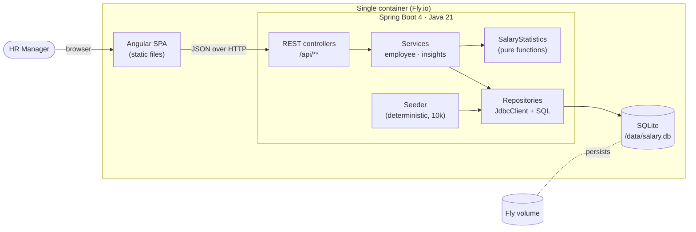
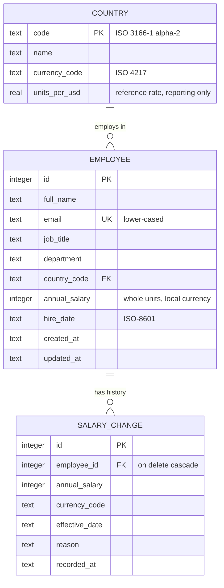

# Architecture and design decisions

## System overview

One deployable unit. Spring Boot serves the REST API **and** the compiled Angular app, backed by a single SQLite file.



**Why one unit:** one URL, no CORS, one thing to deploy and monitor. The UI and API still sit in separate folders (`frontend/`, `backend/`) with their own builds and tests. Splitting them later is a deployment change, not a code change.

## Backend structure: package by feature

```
com.acme.salary
├── employee/     Employee CRUD, search, salary history, CSV export
├── insights/     Pay statistics: org overview, by country, by job title, peer comparison
├── reference/    Countries, currencies, reference FX rates
├── seed/         Deterministic 10k-employee generator + runner
└── web/          Error handling (RFC 9457 problem details), SPA forwarding
```

Each feature owns its controller, service, repository and DTOs, so a reviewer can read one folder end to end. The interesting logic (statistics, peer comparison, data generation) lives in **pure classes with no Spring or database dependency**. That keeps the unit tests fast and deterministic.

## Data model



`employee.annual_salary` is the **current** salary, kept alongside the history. Both are written in one transaction. The directory and insights read one table, and the history is still complete.

## REST API

| Method | Path | Purpose |
|---|---|---|
| `GET` | `/api/employees?q=&country=&department=&jobTitle=&page=&size=&sort=` | Search, filter, sort, paginate |
| `GET` | `/api/employees/export?…same filters` | CSV of the filtered list, in screen order |
| `GET` | `/api/employees/{id}` | Employee with salary history and peer comparison |
| `POST` | `/api/employees` | Create (also writes the first salary-history row) |
| `PUT` | `/api/employees/{id}` | Update; a salary or country change appends history |
| `DELETE` | `/api/employees/{id}` | Remove a mistaken record |
| `GET` | `/api/reference` | Countries, currencies, known departments and job titles |
| `GET` | `/api/insights/overview` | Headcount, payroll (USD), median (USD), payroll by department |
| `GET` | `/api/insights/countries` | Pay statistics per country, in local currency |
| `GET` | `/api/insights/countries/{code}/job-titles` | Pay statistics per job title within a country |

Errors use RFC 9457 `application/problem+json`, with field-level validation errors in the body.

## Key decisions and trade-offs

| Decision | Why | Trade-off accepted |
|---|---|---|
| **Spring Boot 4, Java 21, Angular** | Matches the role. Records, pattern matching and the virtual-thread-ready stack keep the code small. | n/a |
| **SQLite** | Suggested by the brief. Zero ops, a single file, and fast enough for 10k rows by orders of magnitude. | One writer at a time. Fine for one HR manager; moving to Postgres is a datasource and migration change. |
| **`JdbcClient` and SQL rather than JPA** | The work is filtering and aggregation, where explicit SQL is clearer than an ORM. Hibernate's SQLite dialect is community-maintained. | Row mapping is hand-written, a few lines per query. |
| **Flyway migrations** | The schema and reference data are versioned and reviewable. The same path runs in tests and production. | n/a |
| **Statistics computed in Java** (`SalaryStatistics`) | SQLite has no portable `MEDIAN` or `PERCENTILE`. A pure function is trivial to unit-test and matches Excel's `PERCENTILE.INC`, so HR's numbers reconcile. 10k values are sorted in about a millisecond. | Past roughly 1M rows, push this into SQL window functions or pre-aggregate (see [performance notes](05-performance.md)). |
| **Money as whole units of local currency** (`INTEGER`) | No floating-point drift. Annual base salaries are quoted in whole units, and JPY-style currencies have no minor unit. | Cannot store cents. Not needed for annual base salary. |
| **USD normalisation only for reporting** | Mixing currencies in totals is the core spreadsheet bug. Fixed, dated reference rates keep reports reproducible. | Converted figures are approximate and always labelled "≈ USD". |
| **Sorting the directory by salary uses the USD-normalised value** | Sorting raw local amounts would rank ₹ 30,00,000 above $ 250,000. | n/a |
| **Free-text job titles with suggestions** | Matches how HR works today, and suggestions nudge consistency. | No job-architecture levels in v1 (see clarifying question 8). |
| **PrimeNG with custom design tokens, plus hand-built SVG pay-band charts** | Mature data table (lazy loading, sorting, pagination) and form controls, restyled to look like an HR tool rather than a component demo. The pay-band chart is a few lines of SVG and needs no chart library. | n/a |
| **One container on Fly.io with a volume** | The SQLite file survives restarts. Deploys straight from the CLI. | Single instance, which is fine for this workload. |
